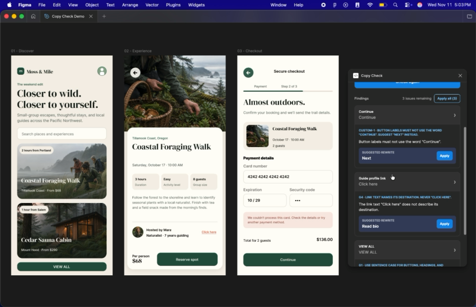
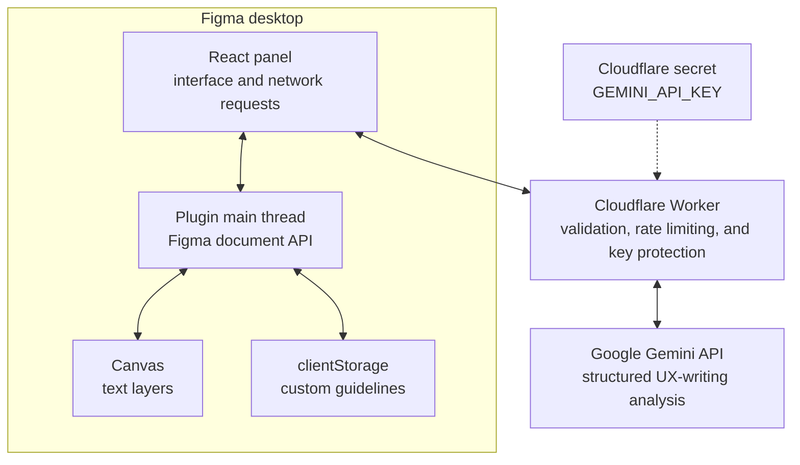

# Copy Check

Copy Check is an AI-assisted Figma plugin that audits UI text against editable UX-writing guidelines and safely applies suggested rewrites in place.

## Demo

[](docs/assets/copy-check-demo.mp4)

[Watch the 47-second demo](docs/assets/copy-check-demo.mp4): editable guidelines → 50-layer audit → findings → in-canvas rewrites → clean recheck.

## Why it exists

Product copy is often reviewed after a design leaves Figma, separating the writing decision from its visual context. Copy Check keeps that review loop on the canvas: a designer can inspect a frame, find likely UX-writing problems, jump to the affected layer, and apply a rewrite without copying text between tools.

This is a focused portfolio project built to demonstrate the intersection of design and engineering: Figma plugin development, React, TypeScript, API design, an LLM integration, and a small serverless back end.

## What it does

- Scans text layers in the current selection, or the current page when nothing is selected.
- Audits up to 100 layers against editable UX-writing guidelines.
- Groups findings by Figma layer and jumps to a layer when its finding is selected.
- Applies one rewrite or all available rewrites directly to the canvas.
- Loads fonts before editing and blocks unsafe changes to mixed- or missing-font layers.
- Treats **Apply all** as one native Figma undo operation.
- Saves custom guidelines to the current Figma user's local plugin storage.
- Shows intentional loading, clean, error, and applied states.

## Architecture



The plugin is split because Figma gives its two runtimes different capabilities. The main thread can read and change the document but has no browser DOM. The React panel can render an interface and make network requests but cannot touch the document directly. Typed messages in `src/shared/messages.ts` form the contract between them.

Only the Cloudflare Worker can access the Gemini key. It validates both sides of the model call, rejects unknown IDs, limits request size, and rate-limits the public audit endpoint.

## Tech stack

| Layer | Technology | Role |
| --- | --- | --- |
| Plugin logic | TypeScript + Figma Plugin API | Scan, navigate, load fonts, edit text, and persist guidelines |
| Panel | React + TypeScript + Vite | Render the audit and guideline-editing experience |
| API | Cloudflare Workers + Zod | Protect the key, validate traffic, and call the model |
| Model | Google Gemini API | Evaluate copy and propose structured rewrites |
| Tooling | npm, esbuild, Vitest | Build the two Figma runtimes and test their contracts |

## Quick start

The fastest route uses the deployed demo Worker already allow-listed in `manifest.json`. Use invented, non-confidential copy: selected text is sent to a public demo endpoint and then to Gemini for analysis.

### Requirements

- [Git](https://git-scm.com/)
- [Node.js](https://nodejs.org/) and npm (tested with Node.js 26.13 and npm 11.20)
- The [Figma desktop app](https://www.figma.com/downloads/)

### Install and build

```bash
git clone https://github.com/stocky151/copy-check-figma-plugin.git
cd copy-check-figma-plugin
npm ci
npm run build
```

The build creates the two files Figma runs:

- `dist/code.js` — the plugin main thread
- `dist/index.html` — the React panel, with its JavaScript and CSS inlined

### Import into Figma

1. Open the Figma desktop app and any design file.
2. Open **Plugins → Development → Import plugin from manifest…**.
3. Select this repository's `manifest.json`.
4. Run **Plugins → Development → Copy Check**.

After source changes, run `npm run build`, close the open plugin panel, and reopen Copy Check in Figma.

## Run your own Worker

The repository never contains a model key. To use your own Gemini and Cloudflare accounts:

1. Create a Gemini API key in [Google AI Studio](https://aistudio.google.com/apikey).
2. Authenticate Wrangler with `npx wrangler login`.
3. Add the production secret with `npx wrangler secret put GEMINI_API_KEY`.
4. Deploy with `npm run worker:deploy`.
5. Replace the Worker origin in both `manifest.json` and `src/ui/App.tsx`, then rebuild the plugin.

For local Worker development, create an ignored `.dev.vars` file from the safe example:

```bash
cp .dev.vars.example .dev.vars
npm run worker:dev
```

Never put a real key in source code, `manifest.json`, a client-side environment variable, or a committed file.

## Commands

| Command | Purpose |
| --- | --- |
| `npm run build` | Type-check and build the panel and plugin main thread |
| `npm run typecheck` | Run all four strict TypeScript configurations |
| `npm test` | Run the contract, validation, and Worker tests |
| `npm run worker:dev` | Start the Worker locally with Wrangler |
| `npm run worker:deploy` | Deploy the Worker to Cloudflare |

## Validation and safeguards

The Worker accepts only JSON matching the shared audit contract. It rejects:

- bodies larger than 64 KiB;
- more than 100 text items or 20 guidelines;
- more than 20,000 combined text characters;
- duplicate or unknown node and guideline IDs;
- malformed or oversized model replies; and
- clients exceeding 10 audit requests per minute per IP at a Cloudflare location.

Gemini receives the minimum data needed for an audit: layer ID, layer name, visible text, editability, and the active guidelines. Requests set `store: false`, but free-tier Gemini API terms may still permit Google to use submitted content to improve products. This demo is therefore intended for invented, non-confidential copy only. See [Gemini API pricing and data-use notes](https://ai.google.dev/gemini-api/docs/pricing).

## Decisions and trade-offs

- **Server-side model access.** A Worker adds deployment complexity, but it keeps the API key out of the downloadable plugin and centralizes validation.
- **Structured output plus runtime validation.** TypeScript cannot verify network data at runtime, so Gemini is asked for schema-constrained JSON and Zod validates the result before it reaches Figma.
- **Safe edits over maximum coverage.** Copy Check loads a layer's font before changing its characters. Version 1 refuses automatic edits when a layer mixes fonts or its font is unavailable.
- **Native undo instead of custom history.** Applying all rewrites creates one Figma undo checkpoint, matching the host application's interaction model.
- **Local guideline persistence.** `clientStorage` makes customization simple and private to a Figma user, but guidelines do not sync as a shared team configuration.
- **Model fallbacks.** Retrying and falling back across Gemini Flash models improves demo reliability, with a possible latency increase during provider errors.
- **Public demo endpoint.** IP rate limiting and strict caps reduce casual abuse without adding sign-in. The limit is approximate and may affect people sharing one network; authentication would be the next step for a production service.

## Testing

```bash
npm test
npm run build
```

Automated tests cover typed message validation, malformed requests and model output, request caps, invented model IDs, deterministic false-positive filters, retry/fallback behavior, and the IP rate limit. The final Figma regression and demo sequence is documented in [docs/final-qa.md](docs/final-qa.md).

## Current limitations

- Model suggestions require human judgment; they are proposals, not authoritative corrections.
- Audits are capped at 100 text layers and 20 guidelines per request.
- Mixed-font and missing-font layers must be edited manually.
- Guidelines are stored per Figma user/device rather than synced to a team.
- The plugin is distributed as source for development import; Figma Community publishing is outside version 1.

## License

[MIT](LICENSE) © 2026 Sean Stocker

## Project notes

- [Learning notes](docs/learning-notes.md)
- [Final QA and demo plan](docs/final-qa.md)
- [Original project specification](Copy%20Check%20Figma%20plugin%20spec.md)
